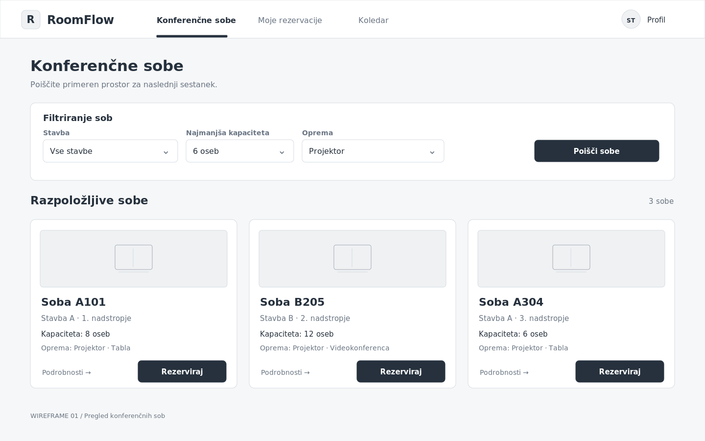
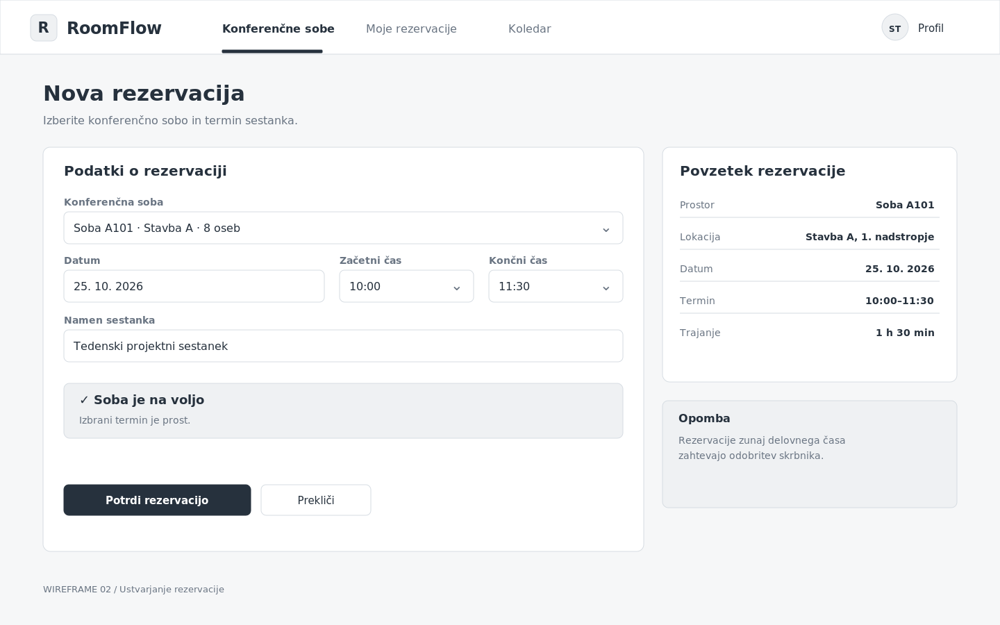
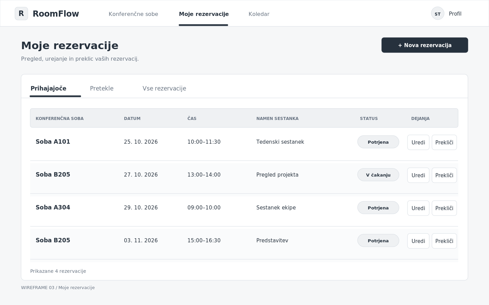

# Wireframes – RoomFlow

## 1. Pregled konferenčnih sob

Wireframe prikazuje glavno stran aplikacije RoomFlow, na kateri uporabnik vidi seznam razpoložljivih konferenčnih sob. Na vrhu je navigacija, pod njo pa filtri za iskanje sob glede na lokacijo, kapaciteto in opremo.

Vsaka soba ima prikazane osnovne podatke in možnost nadaljevanja na rezervacijo.

## 2. Ustvarjanje rezervacije

Wireframe prikazuje obrazec za ustvarjanje nove rezervacije konferenčne sobe. Uporabnik lahko izbere sobo, datum, začetni in končni čas ter vnese namen sestanka.

Na dnu obrazca sta gumba za potrditev rezervacije in preklic postopka. Ob nedostopnem terminu se prikaže opozorilo.

## 3. Uporabnikove rezervacijes

Wireframe prikazuje seznam rezervacij prijavljenega uporabnika. Za vsako rezervacijo so vidni ime konferenčne sobe, datum, čas in status rezervacije.

Uporabnik lahko posamezno rezervacijo uredi ali prekliče. Stran omogoča tudi pregled preteklih rezervacij.